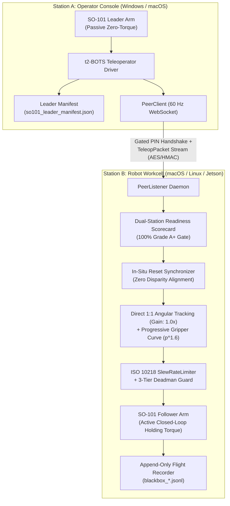
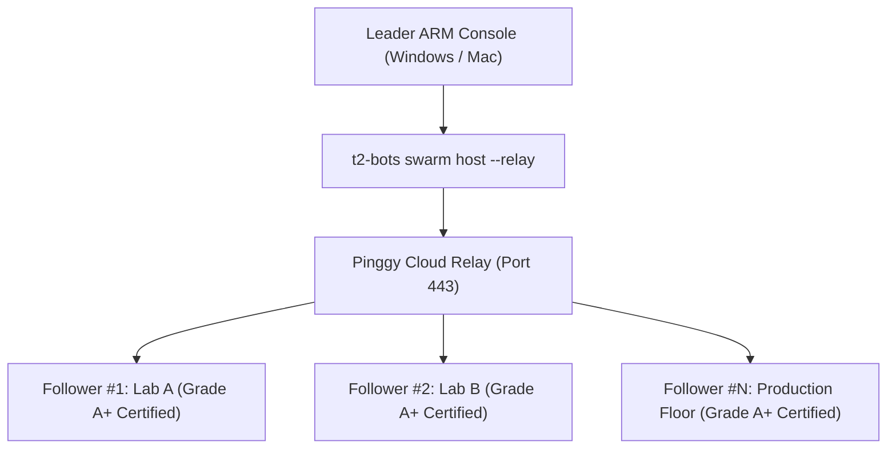

# t2-BOTS SDK — Production User Manual & Operating Guide
**Universal Physical AI Hardware Abstraction Layer & Distributed Teleoperation**  
*Document Version: 2.0 | Software Release: v0.2.0 | Embodiment: SO-101 6-DOF Manipulator*

---

## 1. System Overview & Architecture

The `t2-BOTS` SDK provides a high-speed, decoupled hardware abstraction layer (HAL) connecting **Physical AI policies (VLA, Imitation Learning, PyTorch RL)** and **Distributed Teleoperators** to Feetech STS3215 1 MBaud UART servomotors.



### Key Technical Specs
* **Control Loop Rate**: 60 Hz nominal closed-loop streaming.
* **Bus Latency**: $\le 1.1\text{ ms}$ average bus turnaround at 1,000,000 Baud.
* **Handshake Protocol**: Gated 6-digit PIN authentication with ephemeral room codes.
* **Actuator Embodiment**: 6 $\times$ Feetech STS3215 magnetic encoder servomotors (4096 ticks/rev, $\approx 0.08789^\circ$/tick).

---

## 2. Turnkey Installation Guide

### Prerequisites
* Python 3.9, 3.10, 3.11, or 3.12.
* Supported OS: macOS (Apple Silicon & Intel), Windows 10/11, Linux (Ubuntu/Debian), NVIDIA Jetson, Raspberry Pi 4/5.

### Step 1: Clone the Repository
```bash
git clone https://github.com/roniejosephv-star/t2-BOTS-SDK.git
cd t2-BOTS-SDK
```

### Step 2: Create a Clean Virtual Environment (Recommended)
```bash
# macOS / Linux:
python3 -m venv .venv
source .venv/bin/activate

# Windows (PowerShell):
python -m venv .venv
.venv\Scripts\Activate.ps1
```

### Step 3: Install the SDK
```bash
# One-command editable installation (installs core, driver, and CLI):
pip install -e .

# Or install from pre-built production wheel:
pip install dist/t2_bots-0.2.0-py3-none-any.whl
```

### Step 4: Verify Installation
```bash
t2-bots --help
```
You should see all 13 SDK CLI subcommands listed.

---

## 3. Hardware Commissioning & Qualification

Before operating, each arm must be qualified on its workstation. This step verifies power supply health, unlocks factory firmware limit ceilings, applies thermal soft clearance, and signs an audited manifest.

### Turnkey Qualification Command
```bash
# For a Follower arm:
t2-bots qualify-arm --arm follower

# For a Leader arm:
t2-bots qualify-arm --arm leader
```

### What Qualification Automatically Audits:
1. **Actuator Bus Turnaround & Voltage Audit**:
   Pings all 6 motors ($1 \dots 6$). Verifies that bus voltage is nominal ($11.0\text{V} - 13.5\text{V}$). Fails immediately if any ribbon cable is loose or supply is drooping.
2. **Firmware EEPROM Angle Limit Unlocking**:
   Factory STS3215 servos on Motor 2 (`shoulder_lift`) often come locked at 2659 ticks (~55° forward tilt). The engine unlocks EEPROM write protection (`LOCK = 0`), sets `MAX_ANGLE_LIMIT = 3300`, and re-locks EEPROM. This expands the boom reach by over $+56^\circ$ ($+641$ ticks), unlocking the full ~110° forward workspace.
3. **30-Tick Thermal Soft Clearance Guard**:
   At resting table posture, motors sit 7–20 ticks from physical brackets. Commanding holding torque directly on hard stops draws continuous stall current, driving temperatures to 59°C and latching overload errors (`0x10`). Qualification derives a **30-tick soft clearance baseline**, allowing the arm to float cool ($\le 48^\circ\text{C}$) at near-zero stall current.
4. **Manifest Generation**:
   Emits `~/.config/t2_bots/calibration/so101_<role>_manifest.json` and updates LeRobot cache sync paths.

---

## 4. Distributed Remote Teleoperation

Run across two separate computers on the local Wi-Fi/LAN or over VPN/Internet.

### Workstation B: Follower Daemon (Robot Cell)
```bash
# Start Follower listener with auto-discovery and PIN
t2-bots peer listen --auto --listen-port 8765 --pin 123456
```
The console will display:
```text
=======================================================
🌐 [t2-BOTS] Remote Teleoperation Listener (System B)
   Room Code:  T2-XXXX
   Gated PIN:  123-456
   LAN IP:     192.168.1.14
   Listening:  0.0.0.0:8765
   Follower:   /dev/tty.usbmodem5C821078261 (12.4V Healthy)
=======================================================
```

### Workstation A: Leader Client (Operator Console)
```bash
# Connect to the Follower's IP
t2-bots peer connect --auto --host 192.168.1.14 --pin 123456
```

### The Dual-Station Readiness Scorecard
During the Gated PIN handshake, both monitors will print an un-blinded kinematic scorecard before holding torque engages:

```text
===============================================================
🎯 [t2-BOTS Handshake] Dual-Station Kinematic Readiness Scorecard:
---------------------------------------------------------------
Station A (Leader):   [QUALIFIED_READY] 12.4V | Rest Pose Verified
Station B (Follower): [QUALIFIED_READY] 12.4V | EEPROM Limits Unlocked
Kinematic Mode:       DIRECT 1:1 ANGULAR TRACKING (Gain: 1.0x)
Gripper Shaping:      Feathered Tactile Curve (p^1.6 + EMA Filter)
Readiness Status:     100% (Grade A+)
===============================================================
```

---

## 5. Kinematic Principles & Actuator Shaping

### 1. Direct 1:1 Angular Tracking (Revolute Joints 1–5)
* Earlier approaches attempted dimensionless range normalization ($0.0 \dots 1.0$). Because the human wrist rotated $\approx 500$ ticks while the follower servo rotated $2111$ ticks, this created an accidental $4.22\times$ gear ratio that whipped the wrist violently.
* **The `t2-BOTS` Rule**: Revolute joints use direct angular correspondence ($\Delta \theta_{follower} = \Delta \theta_{leader}$) anchored to the resting baseline:
  $$\theta_{follower, j}(t) = \theta_{follower, rest, j} + (\theta_{leader, j}(t) - \theta_{leader, rest, j})$$
  $1^\circ$ on the Leader wrist produces exactly $1^\circ$ on the Follower claw.

### 2. Progressive Tactile Gripper Curve (Joint 6)
* The Leader uses a short-stroke spring trigger (~350 ticks); the Follower uses a long parallel claw (1511 ticks).
* Input trigger squeeze $p \in [0.0, 1.0]$ is shaped through a super-linear power curve with 2% deadband:
  $$p_{feathered} = \left(\frac{\max(0, p_{leader} - 0.02)}{0.98}\right)^{1.6}$$
* An Exponential Moving Average (EMA, $\alpha = 0.35$) filters potentiometer ADC noise:
  $$p_{smoothed} = 0.65 \cdot p_{smoothed} + 0.35 \cdot p_{feathered}$$
* **Result**: Light finger touches produce millimeter-scale delicate pinch control; full trigger pull locks the claw securely without stalling.

### 3. ISO 10218 Deadman Failsafe
* **Tier 1 (RTT 80–150ms)**: Slew rate limiter suppresses jitter and packet micro-bursts.
* **Tier 2 (RTT > 150ms or silence > 400ms)**: Active holding torque locks position in place.
* **Tier 3 (Silence > 2.0s)**: Emergency graceful deceleration and return to resting home pose.

---

## 6. Complete CLI Master Reference

### `t2-bots detect`
Scans system serial ports and identifies robot controllers by USB vendor descriptors and hardware serial numbers.
```bash
t2-bots detect
```

### `t2-bots qualify-arm`
Independently qualifies an arm, audits voltages, unlocks EEPROM limits, and generates readiness certificate.
```bash
t2-bots qualify-arm --arm <auto|leader|follower> [--port <PORT>] [--clearance 30]
```

### `t2-bots peer listen`
Starts the remote Follower daemon.
```bash
t2-bots peer listen --auto --listen-port 8765 [--pin <6_DIGIT_PIN>] [--sync-mode reset]
```

### `t2-bots peer connect`
Connects the Leader console to the Follower daemon.
```bash
t2-bots peer connect --auto --host <IP> --pin <6_DIGIT_PIN> [--sync-rest]
```

### `t2-bots stream`
Streams real-time 60 Hz joint angles, gripper aperture, and latency diagnostics to terminal.
```bash
t2-bots stream --port /dev/tty.usbmodem5C821078261
```

### `t2-bots home`
Smoothly returns the arm to a calibrated canonical posture (`rest`, `standby`, or `zero`).
```bash
t2-bots home --auto --pose rest --duration 2.5 [--release-torque]
```

### `t2-bots release`
Instantly and safely cuts holding torque across all motors.
```bash
t2-bots release --arm follower
```

### `t2-bots config save`
Permanently locks calibrated home ticks and serial port assignments into `~/.config/t2_bots/rig_config.json`.
```bash
t2-bots config save --name "SO101 Dual-Station Rig - Follower"
```

### `t2-bots config show`
Displays active workstation rig profile.
```bash
t2-bots config show
```

### `t2-bots pose capture` / `goto` / `list`
Manages custom named waypoint positions.
```bash
# Capture current arm pose as a named position
t2-bots pose capture pick_tray --arm follower --desc "Bin picking waypoint"

# Smoothly navigate to saved position
t2-bots pose goto pick_tray --arm follower --duration 2.0

# List all saved positions
t2-bots pose list --arm follower
```

### `t2-bots serve`
Launches the Web Automation Gateway and real-time HTML5 browser dashboard.
```bash
t2-bots serve --host 0.0.0.0 --port 8080
```

### `t2-bots eval`
Runs the `pstack`-inspired hardware benchmark evaluation suite and generates an audited compatibility certificate.
```bash
t2-bots eval --driver so101 --port /dev/tty.usbmodem5C821078261 --output eval_results
```

---

## 7. Python API Guide for Physical AI

### Observation Streaming (VLA / Policy Inference)
```python
from t2_bots.core.registry import get_robot

# Connect to arm
arm = get_robot("so101", port="/dev/tty.usbmodem5C821078261")
arm.connect()

try:
    # 60 Hz low-latency telemetry
    obs = arm.get_observation()
    print("Joint Positions (°):", obs.joint_positions)
    print("Gripper Aperture [0..1]:", obs.gripper_aperture)
    print("Bus Turnaround Latency:", obs.latency_ms, "ms")
finally:
    arm.disconnect()
```

### Sending Closed-Loop Policy Actions
```python
from t2_bots.core.registry import get_robot
from t2_bots.core.schema import RobotAction

arm = get_robot("so101", port="/dev/tty.usbmodem5C821078261")
arm.connect()
arm.set_torque(True)

action = RobotAction(
    target_positions={
        "shoulder_pan": 0.0,
        "shoulder_lift": -45.0,
        "elbow_flex": 60.0,
        "wrist_flex": 30.0,
        "wrist_roll": 0.0,
    },
    target_gripper=0.85, # 85% aperture
    duration_s=0.016,     # 60 Hz step
)
arm.send_action(action)
```

---

## 8. Troubleshooting & Diagnostics Playbook

### 1. `Remote connection error: Connection refused` or `Timed out`
* **Cause**: Windows cannot reach the Follower Mac IP on port 8765.
* **Resolution**:
  1. On Mac, check IP via `ifconfig | grep "inet 192"`.
  2. On Windows PowerShell, test connectivity:
     ```powershell
     Test-NetConnection -ComputerName <MAC_IP> -Port 8765
     ```
  3. If `TcpTestSucceeded : False`: Change Windows Wi-Fi Network Profile from **Public** to **Private** (Windows Settings $\rightarrow$ Network $\rightarrow$ Wi-Fi $\rightarrow$ Private network).
  4. Ensure both computers are connected to the same Wi-Fi router and that router "AP Isolation" / "Client Isolation" is turned **OFF**.

### 2. `Remote connection error: Remote authentication rejected`
* **Cause**: Gated PIN mismatch between client and daemon.
* **Resolution**: Use matching PIN on both sides:
  - On Follower: `t2-bots peer listen --auto --pin 123456`
  - On Leader: `t2-bots peer connect --auto --host <IP> --pin 123456`

### 3. Actuator Overload Stall Flag (`STATUS_ERROR = 0x10`) & Motor Buzzing
* **Cause**: Holding torque was engaged while arm was pressed firmly against table or physical bracket.
* **Resolution**: Run `t2-bots qualify-arm --arm follower`. The qualification engine automatically enforces 30-tick soft clearance off physical hard stops.

### 4. Serial Port Permissions on Linux / Ubuntu
* **Cause**: Current user is not in the `dialout` group.
* **Resolution**:
  ```bash
  sudo usermod -aG dialout $USER
  # Log out and log back in, or run:
  sudo chmod 666 /dev/ttyACM0
  ```

### 5. Motor 2 Refuses Forward Reach Past ~55°
* **Cause**: Servo MCU EEPROM factory register `0x0B` is locked at 2659.
* **Resolution**: Run `t2-bots qualify-arm --arm follower`. It automatically unlocks the EEPROM to 3300 ticks.

---

## 9. Swarm Teleoperation & Multi-Arm Fleet Management ("One-to-Many Movement")

The `t2-BOTS` SDK supports **1-to-$N$ Swarm Teleoperation**, where a single human Leader arm controls an entire fleet of verified Follower arms simultaneously across the public internet.



### 1. Host Swarm Hub (Leader Workstation)
```bash
t2-bots swarm host --auto --pin 123456 --relay
```
* Spawns the WebSocket Master Hub and opens an autonomous Pinggy Cloud Relay reverse tunnel in one step.
* As remote Follower arms connect, the operator's console displays an **Interactive Admission Prompt**:
  ```text
  ========================================================================
  🔔 [SWARM ADMISSION REQUEST]
     Follower Name: Lab-A-M4
     Arm ID:        SO101-FOL-5C821078261
     Voltage:       12.4V (Grade A+)
  👉 Grant teleoperation admission to this Follower? [Y/n]: y
  ========================================================================
  ```
* When accepted, the Follower enters the active broadcast group.
* **Isolated Deadman Safety**: If an individual follower experiences latency ($>150\text{ms}$) or voltage drop ($<11.5\text{V}$), only that specific arm enters safe-hold. All other healthy arms continue tracking at 60 Hz without interruption.

### 2. Connect Follower to Swarm (Remote Station)
```bash
t2-bots swarm join --auto --host tcp://<HUB_TUNNEL_URL>:<PORT> --pin 123456 --name "Lab-Follower-M4"
```

---

## 10. Autonomous Headless Reverse Tunnel Manager (`t2-bots relay`)

Instead of managing manual SSH terminal windows, the SDK provides built-in OpenSSH reverse tunnel lifecycle management:

```bash
# Start background tunnel forwarding to local port 8765
t2-bots relay start --port 8765

# Check live tunnel health, transferred bytes, and active streams
t2-bots relay status

# Cleanly stop tunnel
t2-bots relay stop
```

---

## 11. Cross-Platform Bootstrap & Driver Provisioner (`t2-bots bootstrap`)

Zero-install setup command for freshly unboxed workstations:
```bash
# Audit and auto-configure serial drivers & permissions
t2-bots bootstrap

# Request guided administrator/sudo elevation if udev rules or COM drivers are missing
t2-bots bootstrap --elevate
```
* **Linux**: Installs `/etc/udev/rules.d/99-t2-so101.rules` for CH340, FTDI, and CP210x chipsets; assigns user to `dialout,plugdev`.
* **macOS**: Audits Calling Unit device nodes (`/dev/cu.*`) and verifies native Apple Silicon `arm64` Python execution.
* **Windows**: Detects missing USB-UART drivers and provisions OpenSSH Client optional feature via DISM.

---

## 12. Hardware Qualification Certification (`t2-bots certify`)

Inspects power rails, unclamps Motor 2 EEPROM limits to 3300 ticks with 30-tick soft clearance, verifies homing kinematics, and issues a tamper-evident SHA-256 certificate:

```bash
# Certify Follower Arm
t2-bots certify --arm follower

# Verify existing certificate file
t2-bots certify --verify ~/.config/t2_bots/certificates/SO101-FOL-5C821078261_qualification.json
```

---

## 13. Verification & Test Suite

The entire SDK is covered by **82 unit and integration tests** verifying platform bootstrap, EEPROM unlocking, cryptographic certification, cloud relay, isolated deadman, and 1-to-N swarm broadcast:

```bash
pytest packages/t2-bots-core/tests
# ======================== 82 passed in 2.5s ========================
```
