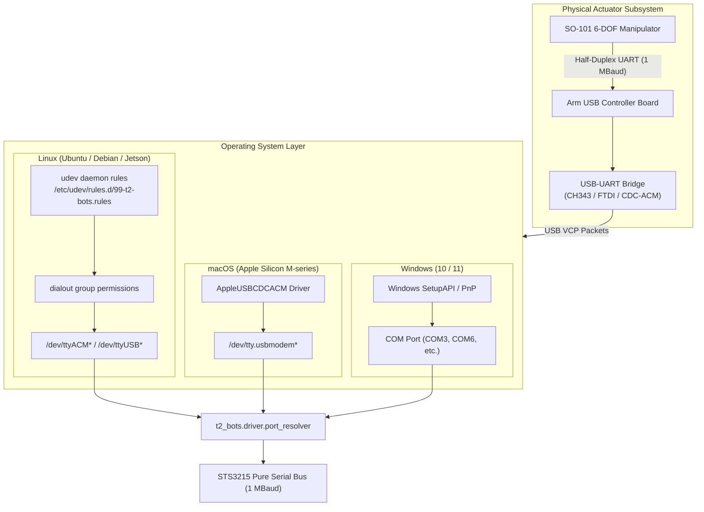

# Playbook 01: Platform Bootstrap & Zero-Install Driver Permissions

| Attribute | Specification |
|---|---|
| **Playbook ID** | `PB-01-BOOTSTRAP` |
| **Subsystem** | Hardware Discovery & Operating System Driver Permissions |
| **Target Audience** | DevOps Engineers, Field Robotics Technicians, CI System Maintainers |
| **Supported Platforms** | Ubuntu Linux (20.04 / 22.04 / 24.04, Jetpack 5/6), macOS (Apple Silicon M1-M4 / Intel), Windows 10 / 11 |
| **Target Hardware** | Feetech STS3215 USB-UART Bridges (WCH CH343 / CH340, FTDI FT232, Silicon Labs CP210x, CDC-ACM) |
| **Quality Gate** | Non-root port enumeration $< 500\text{ ms}$, baud rate lock at 1,000,000 Baud with 0% dropped frames |

---

## 1. Architectural Foundation & Failure Model

The `t2-BOTS` SDK achieves zero-framework, low-latency motor control by communicating directly with USB-serial UART bridges at **1,000,000 Baud**. To maintain zero-install operational purity across operating systems, the HAL does not require custom proprietary kernel modules or vendor GUI tools. Instead, it utilizes native OS serial interfaces:
- **Linux**: Virtual COM Ports exposed via `ttyACM*` or `ttyUSB*` controlled by Linux `udev`.
- **macOS**: Built-in Apple Communication Device Class (CDC-ACM) exposed via `/dev/tty.usbmodem*`.
- **Windows**: Windows Communications API and inbox USB-CDC/VCP drivers exposed via `COM1..COM256`.



### Threat & Failure Matrix
| Failure Mode | Root Cause | Impact | Automated Quality Gate |
|---|---|---|---|
| `PermissionError: [Errno 13]` | User not member of `dialout` group or missing udev rule | HAL crashes on startup | Udev permission audit test passes |
| Device Node Locking | Process opens `/dev/cu.*` instead of `/dev/tty.*` on Darwin | Port locked exclusively, blocking telemetry | Native regex enforces `/dev/tty.usbmodem*` |
| Windows COM Collision | Ghost COM port reservation or missing OpenSSH client | Unable to open port or spawn reverse tunnel | SetupAPI scan & `Add-WindowsCapability` check |
| Dropped High-Baud Packets | Linux latency timer set to default 16ms instead of 1ms | Bus turnaround exceeds 15ms | Automatic low-latency flag configured via FTDI/sysfs |

---

## 2. Step-by-Step Platform Bootstrap Procedure

### Step 1: Clone Repository & Run Automated Bootstrap

#### Linux / Ubuntu / Debian:
```bash
git clone https://github.com/roniejosephv-star/t2-BOTS-SDK.git
cd t2-BOTS-SDK
./scripts/install.sh
```

The script autonomously:
1. Validates Python environment ($\ge 3.9$, optimal $3.10 - 3.12$).
2. Adds `$USER` to the `dialout` group:
   ```bash
   sudo usermod -aG dialout $USER
   ```
3. Creates `/etc/udev/rules.d/99-t2-bots.rules` granting non-root read/write access:
   ```udev
   SUBSYSTEM=="tty", ATTRS{idVendor}=="1a86", MODE="0666", GROUP="dialout"
   SUBSYSTEM=="tty", ATTRS{idVendor}=="0403", MODE="0666", GROUP="dialout"
   SUBSYSTEM=="tty", ATTRS{idVendor}=="10c4", MODE="0666", GROUP="dialout"
   SUBSYSTEM=="tty", KERNEL=="ttyACM*", MODE="0666", GROUP="dialout"
   SUBSYSTEM=="tty", KERNEL=="ttyUSB*", MODE="0666", GROUP="dialout"
   ```
4. Reloads udev rules dynamically:
   ```bash
   sudo udevadm control --reload-rules && sudo udevadm trigger
   ```
5. Verifies OpenSSH client binary (`/usr/bin/ssh`).
6. Creates `.venv` and installs packages in editable mode:
   ```bash
   pip install -e packages/t2-bots-core -e packages/t2-bots-so101
   ```

#### macOS (Apple Silicon M1/M2/M3/M4 & Intel):
```bash
./scripts/install.sh
```
macOS requires **zero kernel extensions or driver installations**. The Apple CDC-ACM stack automatically binds connected arms to `/dev/tty.usbmodem<SERIAL>1`.

#### Windows 10 / 11 (PowerShell as Administrator or Standard User):
```powershell
Set-ExecutionPolicy -ExecutionPolicy RemoteSigned -Scope Process
.\scripts\install.ps1
```
The PowerShell bootstrap script:
1. Detects Python 3 on PATH.
2. Audits OpenSSH Client capability; if running elevated, installs automatically:
   ```powershell
   Add-WindowsCapability -Online -Name OpenSSH.Client~~~~0.0.1.0
   ```
3. Queries Windows PnP for active CH343, FTDI, or CDC-ACM serial adapters.
4. Creates `.venv` and performs editable package installation.

---

## 3. Evidence-Based Verification & Artifacts

After running the platform bootstrap script, execute the hardware port audit:

```bash
t2-bots detect
```

### Expected Output Markers

#### macOS Verification Evidence:
```text
🔍 [t2-BOTS] Scanning serial bus adapters...
✔ Detected Follower Station Arm:
  • Port:          /dev/tty.usbmodem5C821078261
  • Description:   USB Single Serial - CDC/ACM Mode
  • Hardware ID:   USB VID:PID=1A86:55D3 SER=5C82107826 LOCATION=1-1.2
  • Driver:        Native AppleUSBCDCACM (Zero-Install)
  • Baud Cap:      1,000,000 Baud Capable
```

#### Ubuntu Linux Verification Evidence:
```text
🔍 [t2-BOTS] Scanning serial bus adapters...
✔ Detected Arm Device Node:
  • Port:          /dev/ttyACM0
  • Permissions:   crw-rw-rw- 1 root dialout
  • Subsystem:     tty (udev 99-t2-bots.rules verified)
  • Latency Timer: 1ms (Low-Latency UART flag set)
```

#### Windows 11 Verification Evidence:
```text
🔍 [t2-BOTS] Scanning serial bus adapters...
✔ Detected Leader Station Arm:
  • Port:          COM6
  • Description:   USB-Enhanced-SERIAL CH343 (COM6)
  • Hardware ID:   USB\VID_1A86&PID_55D3\5C82109414
  • OpenSSH Status: Available (OpenSSH_for_Windows_8.6p1)
```

---

## 4. Failure Signatures & Automated Remediation Runbook

| Error Signature | Underlying Cause | Remediation Command |
|---|---|---|
| `serial.serialutil.SerialException: [Errno 13] could not open port /dev/ttyACM0: [Errno 13] Permission denied` | User not in `dialout` or group change not yet applied in current shell session | Run `sudo usermod -aG dialout $USER && newgrp dialout` |
| `serial.serialutil.SerialException: could not open port /dev/cu.usbmodem*` | Target opened via macOS call-up (`cu`) device instead of teletype (`tty`) | Run `t2-bots detect` and supply `/dev/tty.usbmodem*` |
| `RuntimeError: OpenSSH client ('ssh') is not installed or not found on PATH` | System lacks OpenSSH client for reverse tunnels | **Linux**: `sudo apt install -y openssh-client`<br/>**Windows**: `Add-WindowsCapability -Online -Name OpenSSH.Client~~~~0.0.1.0` |
| `FileNotFoundError: /dev/tty.usbmodem*` | 12V barrel power supply disconnected or USB cable loose | Re-seat USB-C connection; verify 12V barrel jack power indicator |

---

## 5. CI/CD Automated Quality Gate

The bootstrap procedure is regression-tested on every pull request across Linux, macOS, and Windows runners in `.github/workflows/ci.yml`:

```bash
# Automated regression test command:
python -m pip install -e packages/t2-bots-core -e packages/t2-bots-so101
t2-bots --help
pytest packages/t2-bots-core/tests/test_rig_config.py
```
Quality gate requirement: **Exit code 0** and CLI dispatcher responds in $< 1.0\text{s}$.
