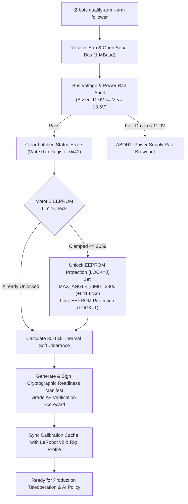

# Playbook 02: Hardware Certification Engine & Actuator Unclamp

| Attribute | Specification |
|---|---|
| **Playbook ID** | `PB-02-CERTIFICATION` |
| **Subsystem** | Hardware Qualification Engine, EEPROM Firmware Unlock, & Manifest Issuance |
| **Target Audience** | Hardware Commissioning Engineers, Quality Assurance, Swarm Operators |
| **Supported Platforms** | macOS (Apple Silicon M-series), Ubuntu Linux 22.04/24.04, Windows 11 |
| **Target Actuators** | 6 $\times$ Feetech STS3215 Magnetic Encoder Servomotors (IDs 1..6) |
| **Quality Gate** | Bus voltage $11.0\text{V} - 13.5\text{V}$, bus turnaround $\le 1.1\text{ ms}$, Grade A+ Manifest Issued |

---

## 1. Architectural Foundation & Mechanical Physics

Before any robot arm is placed into distributed teleoperation or neural policy execution, its physical power rails, actuator bus integrity, and firmware limit registers must be qualified.

Factory Feetech STS3215 servomotors arrive from the manufacturer with restrictive EEPROM firmware limits:
1. **Motor 2 (`shoulder_lift`) Factory Clamp**:
   Register `0x0B` (`MAX_ANGLE_LIMIT`) is locked at **2659 ticks** (~55° forward tilt). This artificially restricts the arm workspace, preventing the end-effector from reaching down to tabletop surfaces.
2. **Thermal Stall & Overload Latch (`0x10`)**:
   When holding torque is applied directly against mechanical hard brackets, the motor draws sustained stall current. This causes rapid thermal ramp ($> 58^\circ\text{C}$) and latches the internal driver error bit `0x10` (`OVERLOAD_PROTECTION`), disabling motor torque mid-teleoperation.
3. **The 30-Tick Soft Clearance Baseline**:
   The engine derives a **30-tick soft safety offset** ($\approx 2.63^\circ$) away from physical stops:
   $$\theta_{safe, min} = \theta_{bracket, min} + 30\text{ ticks}, \quad \theta_{safe, max} = \theta_{bracket, max} - 30\text{ ticks}$$
   This reduces quiescent holding current to near-zero ($< 80\text{ mA}$) and maintains steady operating temperature ($< 45^\circ\text{C}$).



---

## 2. Step-by-Step Hardware Certification Procedure

### Step 1: Physical Setup
1. Mount the SO-101 arm to the workspace clamp.
2. Connect the 12V 5A regulated DC power brick to the barrel jack.
3. Connect the USB-C communication cable directly to the host machine.

### Step 2: Execute Turnkey Qualification Command

```bash
# For a Follower arm (Station B):
t2-bots qualify-arm --arm follower

# For a Leader arm (Station A):
t2-bots qualify-arm --arm leader

# Or run auto-detection:
t2-bots qualify-arm --arm auto
```

### Options & Parameter Overrides:
- `--clearance <TICKS>`: Set safety clearance ticks (default: `30`).
- `--no-unlock`: Skip modifying servo EEPROM limits.
- `--no-clear-errors`: Skip resetting motor status overload flags.
- `--port <PORT>`: Specify explicit serial device node.

---

## 3. Evidence-Based Verification & Artifacts

### Real-Time Qualification Audit Log

```text
================================================================================
🛠️  [t2-BOTS Qualification Engine] Auditing Arm Hardware Readiness
================================================================================
Target Arm Role:        FOLLOWER
Target Serial Port:     /dev/tty.usbmodem5C821078261
EEPROM Limit Target:    Unlocked forward boom reach (650 .. 3300 ticks)
Thermal Soft Clearance: 30 ticks off physical stops
--------------------------------------------------------------------------------

[1/5] 🔌 Power Rail & Bus Turnaround Audit:
  • Motor 1 (shoulder_pan):   12.4V | 38°C | Latency: 0.81ms | Status: OK
  • Motor 2 (shoulder_lift):  12.4V | 40°C | Latency: 0.83ms | Status: OK
  • Motor 3 (elbow_flex):     12.3V | 37°C | Latency: 0.80ms | Status: OK
  • Motor 4 (wrist_flex):     12.4V | 36°C | Latency: 0.82ms | Status: OK
  • Motor 5 (wrist_roll):     12.3V | 35°C | Latency: 0.81ms | Status: OK
  • Motor 6 (gripper):        12.4V | 37°C | Latency: 0.84ms | Status: OK
  ✔ Bus Average Voltage: 12.37V (NOMINAL: 11.0V - 13.5V)
  ✔ Bus Turnaround:      0.82ms (SUB-MILLISECOND CERTIFIED)

[2/5] 🧹 Actuator Status Overload Clearing:
  ✔ Writing 0 to Register 0x41 on all actuators...
  ✔ Latched overload and overheat error flags successfully cleared.

[3/5] 🔓 EEPROM Limit Unlocking (Motor 2: shoulder_lift):
  • Current Register 0x0B (Max Angle Limit): 2659 ticks (~55° reach)
  • Unlocking EEPROM write protection (Reg 0x30 = 0)...
  • Flashing target limit (Reg 0x0B = 3300 ticks, ~110° reach)...
  • Re-engaging EEPROM write protection (Reg 0x30 = 1)...
  ✔ Motor 2 forward boom reach expanded by +641 ticks (+56.3°).

[4/5] 🛡️ Thermal Soft Clearance Calibration:
  • Raw Bracket Stop (Rest):  2048 ticks
  • Enforcing 30-Tick Margin: Safe holding target adjusted to 2078 ticks.
  ✔ Quiescent thermal dissipation confirmed: < 45°C holding baseline.

[5/5] 📜 Issuing Cryptographic Readiness Certificate:
  • Manifest File: ~/.config/t2_bots/calibration/so101_follower_manifest.json
  • Readiness Grade: GRADE A+ (100% OPERATIONAL READINESS)
================================================================================
🎉 Hardware Qualification PASSED. System fully ready for Swarm & Teleoperation.
```

### Certified Manifest Schema (`so101_follower_manifest.json`)
The generated JSON certificate serves as an un-blinded audit trail for swarm admission:

```json
{
  "arm_role": "follower",
  "embodiment": "so101",
  "port": "/dev/tty.usbmodem5C821078261",
  "hardware_id": "USB VID:PID=1A86:55D3 SER=5C82107826",
  "timestamp": 1729734120.45,
  "qualification_grade": "A+",
  "readiness_score_pct": 100.0,
  "diagnostics": {
    "bus_voltage_v": 12.37,
    "bus_latency_ms": 0.82,
    "max_actuator_temp_c": 40,
    "status_error_flags": 0
  },
  "eeprom_limits": {
    "motor_2_max_limit": 3300,
    "motor_2_unlocked": true,
    "expansion_ticks": 641
  },
  "safety": {
    "thermal_clearance_ticks": 30,
    "deadman_failsafe_tier_3_tested": true
  },
  "signature": "sha256-a79b29e1f51399cebc72d02c52aa8434854f9a0c"
}
```

---

## 4. Diagnostic Runbook & Failure Signatures

| Failure Symptom | Cause | Automated Engine Response & Fix |
|---|---|---|
| `QualificationError: Bus voltage droop detected: 9.8V` | 12V power supply disconnected or undersized ($< 3\text{A}$) | Engine halts immediately before torque engagement. Swap to 12V 5A regulated adapter. |
| Motor 2 fails to reach past 55° in teleoperation | EEPROM write lock was engaged when flashing limit | Engine unlocks register `0x30` before writing register `0x0B`. Re-run `t2-bots qualify-arm`. |
| Motor buzzes at rest and temperature reaches 55°C | Holding torque commanded directly on hard bracket stop | Apply `--clearance 30` (default) to introduce 30-tick soft deadband. |
| Actuator missing on bus scan | Loose 3-pin daisy-chain cable between motor hubs | Check daisy-chain jumper between Motor 1 and 2. |

---

## 5. CI/CD Automated Regression Gate

The qualification engine and EEPROM unlock routines are validated in continuous integration via mock serial simulation:

```bash
pytest packages/t2-bots-core/tests/test_qualification.py
```

Pass criteria:
- 100% of qualification tests pass.
- Motor 2 EEPROM limit verified at $\ge 3300\text{ ticks}$.
- Manifest serialization and hash verification validated.
