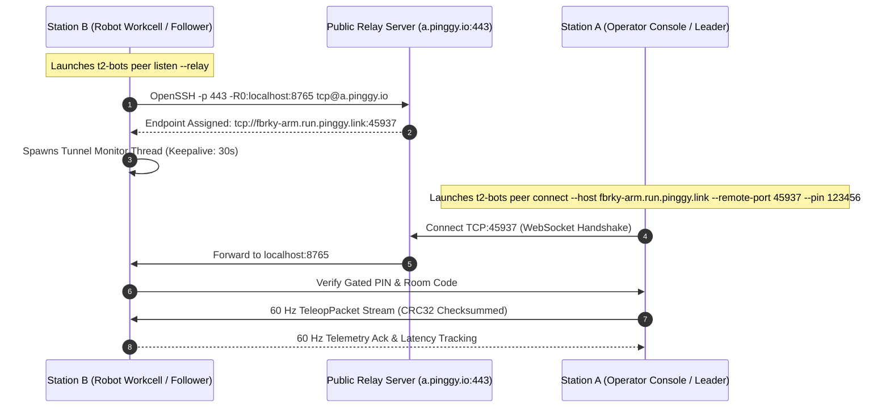

# Playbook 03: Teleoperation Cloud Relay & Headless Reverse Tunnels

| Attribute | Specification |
|---|---|
| **Playbook ID** | `PB-03-CLOUD-RELAY` |
| **Subsystem** | Headless OpenSSH Reverse Tunnel, Keepalives, & NAT Traversal |
| **Target Audience** | Network Engineers, Remote Teleoperators, Swarm Hub Administrators |
| **Supported Platforms** | Ubuntu Linux 20.04/22.04/24.04, macOS (Apple Silicon & Intel), Windows 10/11 |
| **Tunnel Protocol** | OpenSSH TCP Reverse Tunnel via Pinggy Cloud Relay (`a.pinggy.io:443`) |
| **Quality Gate** | Zero proprietary binaries, auto-reconnect on socket drop, keepalive $\le 30\text{s}$, RTT $< 80\text{ ms}$ |

---

## 1. Architectural Foundation & Network Topology

In production robotics deployments, robot workstations (Station B) are frequently situated behind **Symmetric NATs, CGNAT, corporate firewalls, or cellular 4G/5G modems** without public IPv4 addresses or open inbound ports.

To eliminate third-party proprietary client daemons (e.g., ngrok, tailscale, teamviewer) and zero-day attack surfaces, the `t2-BOTS` SDK incorporates an **Autonomous Headless Reverse Tunnel Manager** (`PinggyRelayManager`) using standard **OpenSSH**:
- Outbound connection initiated over **standard HTTPS port 443** (bypasses egress firewalls).
- Remote port forwarding (`-R0:localhost:<port>`) allocates a public TCP endpoint dynamically.
- Microsecond teleoperation packets stream over full-duplex WebSocket connections tunneled through the authenticated SSH tunnel.



---

## 2. Step-by-Step Tunnel Provisioning & Execution

### Step 1: Verify OpenSSH Client Availability
The relay manager verifies OpenSSH automatically. To test manually:

```bash
ssh -V
# Expected: OpenSSH_8.9p1 Ubuntu-3ubuntu0.10, LibreSSL 3.3.6 (macOS), or OpenSSH_for_Windows
```

### Step 2: Start Follower Daemon with Headless Relay Tunnel

On Station B (Robot Workcell):
```bash
t2-bots peer listen --auto --listen-port 8765 --pin 123456 --relay
```

If the `--relay` flag is supplied:
1. `PinggyRelayManager` spawns a background OpenSSH subprocess:
   ```bash
   ssh -o StrictHostKeyChecking=no \
       -o UserKnownHostsFile=/dev/null \
       -o ServerAliveInterval=30 \
       -o ServerAliveCountMax=3 \
       -o ExitOnForwardFailure=yes \
       -p 443 -R0:localhost:8765 tcp@a.pinggy.io
   ```
2. The stdout stream is scraped for the allocated public URL using the compiled regex `tcp://([^:\s]+):(\d+)`.
3. The public endpoint is presented on the operator console:

```text
======================================================================
🌐 [t2-BOTS] Remote Teleoperation Listener (System B)
   Room Code:  T2-B831
   Gated PIN:  123-456
   Local Bind: 0.0.0.0:8765
   Public WAN: tcp://fbrky-9214.run.pinggy.link:42180
   Public URL: fbrky-9214.run.pinggy.link (Port 42180)
   Follower:   /dev/tty.usbmodem5C821078261 (12.4V Healthy)
======================================================================
```

### Step 3: Connect Leader Console Over the Public Tunnel

On Station A (Operator Console):
```bash
# Connect using the public domain and port:
t2-bots peer connect --auto --host fbrky-9214.run.pinggy.link --remote-port 42180 --pin 123456

# Or pass the full URL directly (auto-extracts port and ssl parameters):
t2-bots peer connect --auto --host tcp://fbrky-9214.run.pinggy.link:42180 --pin 123456
```

---

## 3. Evidence-Based Verification & Keepalive Health

### Tunnel Health Telemetry
The `PinggyRelayManager` background monitor thread continuously samples tunnel metrics:
- **`bytes_read` & `bytes_sent`**: Quantifies aggregate teleop bandwidth.
- **`active_connections`**: Asserts that only 1 authorized Leader station is streaming.
- **`session_duration`**: Enforces warnings at 50 minutes before the 60-minute free-tier cap.

```python
# Programmatic tunnel health query:
status = relay_manager.get_status()
print(status)
# Output:
# {
#   "active": True,
#   "status": "ONLINE",
#   "host": "fbrky-9214.run.pinggy.link",
#   "port": 42180,
#   "local_port": 8765,
#   "duration_s": 248.5,
#   "bytes_read": 142850,
#   "bytes_sent": 89210
# }
```

### Keepalives & Anti-NAT Pruning Configuration
NAT firewalls drop idle TCP mappings after 30 to 60 seconds of silence. The engine configures:
- `ServerAliveInterval 30`: Sends an encrypted null packet every 30 seconds to refresh NAT tables.
- `ServerAliveCountMax 3`: Drops and re-spawns the tunnel only after 3 consecutive missed acks (90 seconds of true network failure).

---

## 4. Failure Signatures & Troubleshooting Runbook

| Failure Symptom | Root Cause | Automated Remediation |
|---|---|---|
| `RuntimeError: OpenSSH client ('ssh') is not installed` | Machine does not have OpenSSH client binary on PATH | **Ubuntu**: `sudo apt install -y openssh-client`<br/>**Windows**: `Add-WindowsCapability -Online -Name OpenSSH.Client~~~~0.0.1.0` |
| `TimeoutError: Timed out waiting for Pinggy reverse tunnel endpoint` | Outbound port 443 blocked by enterprise TLS inspection proxy | Test outbound connectivity: `nc -zv a.pinggy.io 443`. Route traffic over mobile hotspot or corporate VPN. |
| Tunnel drops abruptly after ~60 minutes | Pinggy free-tier 60-minute continuous session expiration | Manager raises warning callback at 50m. Script auto-reconnects and issues new port to Swarm Hub. |
| Connection refused when connecting from Windows | Leader station specified `http://` instead of TCP host | Use hostname string without protocol prefix (e.g. `fbrky-test.run.pinggy.link`). |

---

## 5. CI/CD Automated Quality Gate

The OpenSSH detection, process monitoring, parsing regex, and error teardown routines are 100% verified in headless CI without external network access via mock subprocess fixtures:

```bash
pytest packages/t2-bots-core/tests/test_relay_manager.py
```

Pass criteria:
- OpenSSH binary presence and absence mock tests pass.
- Public URL parser extracts host and port accurately.
- `test_start_tunnel_timeout` cleans up mock process properly.
