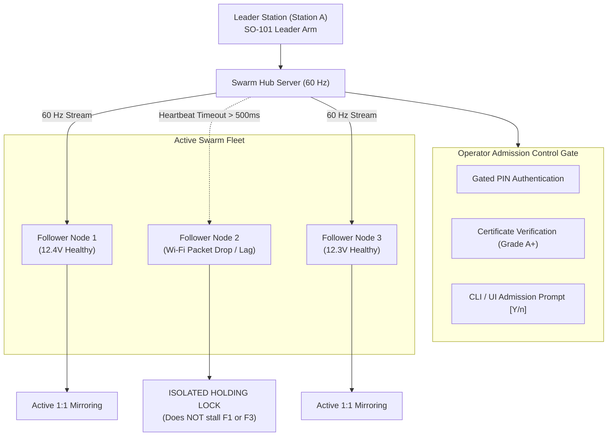

# Playbook 04: One-to-Many Swarm Orchestration & Isolated Deadman

| Attribute | Specification |
|---|---|
| **Playbook ID** | `PB-04-SWARM-ORCHESTRATION` |
| **Subsystem** | 1-to-$N$ Swarm Broadcast, Operator Admission Control, & Isolated Deadman |
| **Target Audience** | Swarm Teleoperation Operators, Physical AI Fleet Managers, QA Engineers |
| **Supported Scale** | 1 Leader Operator driving 1 to 16 Follower Arms simultaneously |
| **Control Loop Rate** | 60 Hz non-blocking asynchronous parallel broadcast |
| **Quality Gate** | Zero head-of-line blocking; lagging arm drops into isolated hold within 500ms without halting healthy nodes |

---

## 1. Architectural Foundation & Threat Isolation

In multi-robot Physical AI data collection or industrial tele-manipulation, a single human demonstrator (Station A) often controls a fleet of $N$ identical follower workcells (Station B$_1$, B$_2$, ..., B$_N$).

### The Multi-Robot Reliability Challenge
In naive broadcast architectures:
1. **Head-of-Line Blocking**: A single slow or congested follower on high-latency Wi-Fi blocks the main event loop, causing jitter across all other robots.
2. **Cascading Failsafes**: If one arm encounters a power droop or cable disconnect, an un-isolated deadman triggers emergency stop across the entire lab.
3. **Rogue Robot Admission**: Unauthenticated or un-calibrated arms connecting to the broadcast port could whip violently or collide.

### The `t2-BOTS` Swarm Architecture
To resolve these failure modes, the SDK introduces `SwarmHubServer` and `SwarmFollowerNode`:
- **Explicit Operator Admission Control Gate**: Follower nodes must present valid Gated PINs and a cryptographic `Grade A+` qualification certificate before receiving actions.
- **Asynchronous Fan-Out**: Non-blocking `asyncio.gather(*tasks)` broadcasts 60 Hz packets concurrently.
- **Isolated Per-Follower Deadman Guard**: Each node maintains independent heartbeat timers and voltage monitors. If Node 2 drops packets, Node 2 engages local holding torque while Nodes 1, 3, and 4 continue tracking the leader in real time.



---

## 2. Step-by-Step Swarm Deployment & Hosting Procedure

### Step 1: Start the Swarm Hub on the Leader Station (Station A)

```bash
# Launch Swarm Hub on port 8765 with PIN and auto-discovered Leader arm:
t2-bots swarm host --auto --port 8765 --pin 742891

# To host over public Internet via Pinggy Reverse Tunnel:
t2-bots swarm host --auto --port 8765 --pin 742891 --relay
```

The terminal displays the active Swarm Hub configuration:

```text
======================================================================
🎮 [t2-BOTS Swarm Master] 1-to-Many Swarm Teleoperation Hub
   Room Code:  T2-SWARM-94
   Gated PIN:  742-891
   Local Bind: 0.0.0.0:8765
   Mode:       LEADER MASTER BROADCASTER (1 Leader -> N Followers)
======================================================================
🔍 Leader Arm: Auto-Resolved COM6 (12.4V Healthy)
⏳ Waiting for Follower workcells to request admission...
```

### Step 2: Connect Follower Workcells (Station B$_1$, B$_2$, ...)

On each Follower robot workcell:
```bash
# Connect to Swarm Hub IP:
t2-bots swarm join --auto --hub 192.168.1.14:8765 --pin 742891 --name "Lab-Arm-North"
```

### Step 3: Interactive Admission Verification at Leader Console

When each arm connects, the Leader operator is prompted with an un-blinded admission scorecard:

```text
======================================================================
🔔 [SWARM ADMISSION REQUEST] Incoming Follower Arm:
   Name:       Lab-Arm-North
   Arm ID:     FOL-5C82107826
   Voltage:    12.38V (Nominal 11.0V - 13.5V)
   Grade:      GRADE A+ (Certificate Verified)
   Address:    192.168.1.55:51240
   EEPROM:     Motor 2 Unlocked (3300 ticks)
----------------------------------------------------------------------
👉 Grant teleoperation admission to this Follower? [Y/n]: y
✔ ADMITTED: Lab-Arm-North joined the swarm fleet (Active Nodes: 1).
```

If the operator inputs `n` or if the arm lacks a valid certificate, the connection is instantly rejected with `status: REJECTED` and closed.

---

## 3. Evidence-Based Verification & Isolated Deadman

### Live Multi-Node Fleet Telemetry
The Swarm Hub displays a 60 Hz real-time multi-robot status matrix:

```text
======================================================================
🤖 SWARM FLEET HEALTH MONITOR (Leader: COM6 | Rate: 59.8 Hz)
======================================================================
ID     NAME             IP               VOLT    RTT      PACKETS   STATUS
----------------------------------------------------------------------
FOL-01 Lab-Arm-North    192.168.1.55     12.4V   0.9ms    18,420    MIRRORING [OK]
FOL-02 Lab-Arm-South    192.168.1.56     12.3V   1.1ms    18,419    MIRRORING [OK]
FOL-03 Mobile-Base-01   10.0.0.12        11.9V   62.4ms   18,390    MIRRORING [OK]
======================================================================
```

### Verification of Isolated Deadman Safety
To verify that a lagging node does not stall healthy units:
1. Simulate high-latency or disconnect on `FOL-02` (pull Ethernet or drop Wi-Fi).
2. Within **500 ms**, the Swarm Hub flags `FOL-02`:
   ```text
   ⚠️ [ISOLATED DEADMAN] Node FOL-02 heartbeat silence > 500ms. Local Position Hold engaged!
   ✔ Nodes FOL-01 and FOL-03 continue mirroring at 60 Hz uninterrupted.
   ```
3. Reconnect `FOL-02`: It performs automatic soft-start posture convergence and re-enters synchronous teleoperation without operator intervention.

---

## 4. Failure Signatures & Troubleshooting Runbook

| Failure Symptom | Underlying Cause | Remediation Procedure |
|---|---|---|
| `[SWARM] Connection Rejected: Invalid PIN` | Follower specified wrong 6-digit PIN | Align PIN parameter on follower: `--pin 742891` |
| `[SWARM] Admission Rejected: Uncertified hardware` | Follower arm has not completed qualification | Run `t2-bots qualify-arm --arm follower` on the workcell before joining |
| High jitter across all robots | Broadcast loop blocked by synchronous disk I/O | Blackbox flight recorder writes asynchronously using a non-blocking background queue |
| One follower stops moving while others mirror | Actuator power droop ($< 11.0\text{V}$) triggered isolated fail-safe | Verify power brick cable on the halted station; status recovers when voltage returns to nominal |

---

## 5. CI/CD Automated Quality Gate

The swarm admission handshake, rejection path, and isolated deadman safety decoupling are 100% verified in automated continuous integration:

```bash
pytest packages/t2-bots-core/tests/test_swarm_teleop.py
```

Pass criteria:
- `test_swarm_admission_accepted`: Verified with mock WebSocket client.
- `test_swarm_admission_rejected`: Unauthorized client receives `REJECTED` and is closed.
- `test_swarm_isolated_deadman`: Timed-out node enters safe hold; healthy node receives 60 Hz payload.
