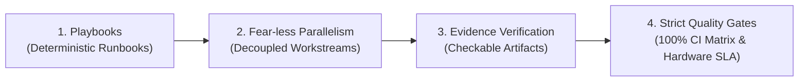
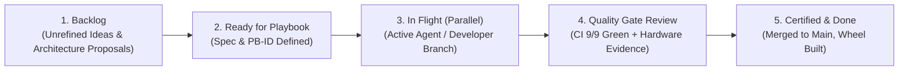

# Playbook 05: DevOps Infrastructure, GitHub Projects v2, & Quality Gates

| Attribute | Specification |
|---|---|
| **Playbook ID** | `PB-05-DEVOPS-CICD` |
| **Subsystem** | Continuous Integration, GitHub Projects v2, PR Quality Gates, & Multi-OS Matrix |
| **Target Audience** | DevOps Engineers, Project Maintainers, Roboticists, Autonomous AI Agents |
| **Methodology** | `pstack` (Inspired by Lauren Tan / Cursor plugins: Playbooks, Fear-less Parallelism, Evidence-Based Verification, Strict Quality Gates) |
| **CI Matrix** | 9 Matrix Jobs: Ubuntu Latest, macOS 14 (Apple Silicon), Windows Latest $\times$ Python 3.10, 3.11, 3.12 |
| **Release Target** | Pure Python Wheel (`t2_bots-*.whl`) and Source Distribution (`tar.gz`) |

---

## 1. Architectural Foundation & The `pstack` Methodology

The `t2-BOTS` SDK adheres to the **`pstack` engineering methodology**, designed for high-velocity, deterministic robotics software development where hardware risks (motor stall, thermal runaway, runaway torque) make standard loose web development workflows unacceptable.

### The Four Pillars of `pstack`



1. **Playbooks (Deterministic Runbooks)**:
   Every deployment, qualification, and calibration step is codified into an un-blinded, repeatable Markdown playbook with explicit inputs, commands, expected terminal markers, and failure signatures.
2. **Fear-less Parallelism (Decoupled Workstreams)**:
   Multiple engineers and autonomous agents work simultaneously on isolated packages (`t2-bots-core`, `t2-bots-so101`, `network`, `gateway`) without branch conflicts or shared runtime locks.
3. **Evidence-Based Verification (Checkable Artifacts)**:
   Code changes are never accepted on assertion alone. Every PR must submit empirical evidence: hardware benchmark JSON scorecards, qualification manifests (`so101_*_manifest.json`), blackbox flight recorder logs, or CI test matrices.
4. **Strict Quality Gates (Zero-Drop Merge Enforcement)**:
   Automated GitHub Actions workflows block regressions before merge: 100% test pass across 3 operating systems, sub-millisecond bus latency, and wheel package integrity.

---

## 2. GitHub Projects v2 Board Configuration

The `t2-BOTS` SDK project management board is configured in GitHub Projects v2 with the following custom columns, views, and automation rules:

### Project Board Views & Columns



### Custom Board Metadata Schema

| Field Name | Type | Options / Validation Format | Purpose |
|---|---|---|---|
| **Phase** | Single Select | `Phase 1: HAL`, `Phase 2: Services`, `Phase 3: Verification`, `Phase 4: Gateway`, `Phase 5: Swarm & Vision`, `Phase 6: Release` | Track milestone alignment with `ROADMAP.md` |
| **Playbook ID** | Text | `PB-01` through `PB-05` | Direct link to operational runbook |
| **Subsystem** | Single Select | `core`, `driver-so101`, `network`, `safety`, `eval`, `gateway`, `cli`, `devops` | Package and code boundary isolation |
| **Evidence Type** | Multi Select | `Hardware Manifest`, `Scorecard JSON`, `CI Matrix 9/9 Pass`, `Flight Blackbox JSONL` | Empirical proof attached to issue or PR |
| **Quality Gate Status**| Single Select | `🔴 Blocked`, `🟡 Pending Verification`, `🟢 Passed Grade A+` | Automated merge gate check |

### Automation Workflows
- **On PR Open**: Card automatically transitions to `In Flight (Parallel)`.
- **On CI Pass (9/9 matrix jobs)**: Card moves to `Quality Gate Review`.
- **On Main Merge**: Card moves to `Certified & Done` and closes linked issue.

---

## 3. GitHub Actions Continuous Integration Matrix

The repository CI workflow is maintained at `.github/workflows/ci.yml`. It executes a **3 $\times$ 3 test matrix across all tier-1 supported operating systems and Python runtimes**:

### The 9-Cell Multi-OS Matrix

| Operating System | Architecture | Python Versions | Runner Tag |
|---|---|---|---|
| **Ubuntu Linux** | x86_64 | 3.10, 3.11, 3.12 | `ubuntu-latest` |
| **macOS** | Apple Silicon (M-series ARM64) | 3.10, 3.11, 3.12 | `macos-14` |
| **Windows** | x64 / AMD64 | 3.10, 3.11, 3.12 | `windows-latest` |

### Workflow Execution Pipeline (`.github/workflows/ci.yml`)

```yaml
name: CI / Multi-OS Test Matrix & Packaging Gates

on:
  push:
    branches: [ main, master ]
  pull_request:
    branches: [ main, master ]
  workflow_dispatch:

concurrency:
  group: ${{ github.workflow }}-${{ github.ref }}
  cancel-in-progress: true

jobs:
  test-matrix:
    name: Test (${{ matrix.os }}, Py ${{ matrix.python-version }})
    runs-on: ${{ matrix.os }}
    strategy:
      fail-fast: false
      matrix:
        os: [ubuntu-latest, macos-14, windows-latest]
        python-version: ['3.10', '3.11', '3.12']

    steps:
      - name: Check out repository
        uses: actions/checkout@v4

      - name: Set up Python ${{ matrix.python-version }}
        uses: actions/setup-python@v5
        with:
          python-version: ${{ matrix.python-version }}
          cache: 'pip'

      - name: Install build tools & test harness
        run: |
          python -m pip install --upgrade pip setuptools wheel build
          python -m pip install pytest pytest-cov pytest-asyncio fastapi uvicorn pydantic

      - name: Install packages in editable mode
        run: |
          pip install -e packages/t2-bots-core -e packages/t2-bots-so101

      - name: Validate CLI entry points
        run: |
          t2-bots --help

      - name: Run pytest with coverage
        run: |
          pytest packages/t2-bots-core/tests --cov=t2_bots --cov=t2_bots_so101 --cov-report=xml:coverage-${{ matrix.os }}-py${{ matrix.python-version }}.xml --cov-report=term-missing

      - name: Upload coverage artifact
        uses: actions/upload-artifact@v4
        if: always()
        with:
          name: coverage-${{ matrix.os }}-py${{ matrix.python-version }}
          path: coverage-*.xml
          if-no-files-found: ignore

  package-verification:
    name: Package Build & Distribution Audit
    runs-on: ubuntu-latest
    needs: test-matrix
    steps:
      - name: Check out repository
        uses: actions/checkout@v4

      - name: Set up Python 3.12
        uses: actions/setup-python@v5
        with:
          python-version: '3.12'

      - name: Install build & validation tools
        run: |
          python -m pip install --upgrade pip build twine wheel

      - name: Build root source distribution and wheel
        run: |
          python -m build

      - name: Audit distribution packages
        run: |
          python -m twine check dist/*

      - name: Smoke test clean wheel installation
        run: |
          python -m venv test_env
          . test_env/bin/activate
          pip install dist/*.whl
          t2-bots --help
```

---

## 4. Pull Request Review Gates & Merge Checklist

To merge any pull request into `main`, the branch must satisfy all **5 Quality Gates**:

### Gate 1: 100% CI Matrix Pass (9/9 Jobs Green)
- All 9 matrix runners (`ubuntu-latest`, `macos-14`, `windows-latest` across Python 3.10, 3.11, 3.12) must exit with code 0.
- `package-verification` job must successfully build and validate wheels.

### Gate 2: Zero Framework Bloat Violation
- **Rule**: Core HAL and motor bus must NOT depend on PyTorch, ROS2, or CUDA.
- **Verification**: Run `python -c "import t2_bots; import sys; assert 'torch' not in sys.modules and 'rospy' not in sys.modules"`

### Gate 3: Safety Failsafe Coverage
- Any modification to network protocol, packet framing, or bus IO must pass `test_safety_layer.py` and `test_network_teleop.py`.
- 3-tier deadman failsafe tests must verify active holding torque within $\le 200\text{ ms}$ upon packet loss.

### Gate 4: Empirical Evidence Submission
Every PR description must contain an **Evidence Block** structured as:
```markdown
### pstack Evidence Artifacts
- **Playbook Executed**: PB-02-CERTIFICATION
- **Test Matrix Result**: 9/9 Green across macOS, Ubuntu, Windows
- **Hardware Verified**: SO-101 Follower Arm on `/dev/tty.usbmodem5C821078261`
- **Bus Latency**: 0.82 ms average (Goal: <= 1.1 ms)
- **Voltage Rail**: 12.37 V nominal
- **Attached Artifacts**: `so101_follower_manifest.json`, `EVAL_REPORT.json`
```

### Gate 5: Packaging & Distribution Smoke Test
- The root wheel build `dist/t2_bots-*.whl` must install in a blank virtual environment without network flags:
  ```bash
  python -m venv /tmp/clean_env
  /tmp/clean_env/bin/pip install dist/*.whl
  /tmp/clean_env/bin/t2-bots --help
  ```

---

## 5. Local Pre-Commit & Verification Commands

Developers and CI runners can execute the full local validation pass before opening a PR:

```bash
# 1. Install local editable packages
pip install -e packages/t2-bots-core -e packages/t2-bots-so101

# 2. Run test suite with full coverage
pytest packages/t2-bots-core/tests --cov=t2_bots --cov=t2_bots_so101

# 3. Build and verify distribution wheel
python -m build
twine check dist/*

# 4. Verify YAML workflow files
python3 -c "import yaml; yaml.safe_load(open('.github/workflows/ci.yml'))"
```
When all 4 steps exit code 0, the branch is ready for merge.
